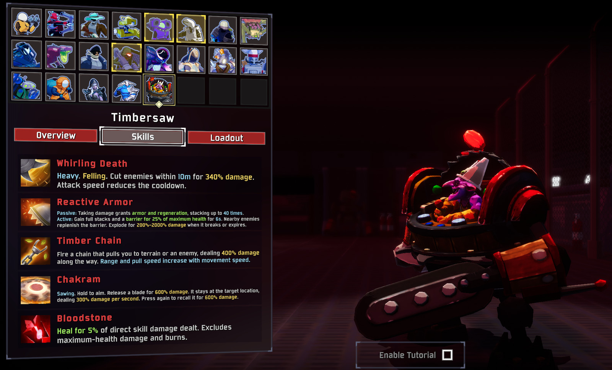
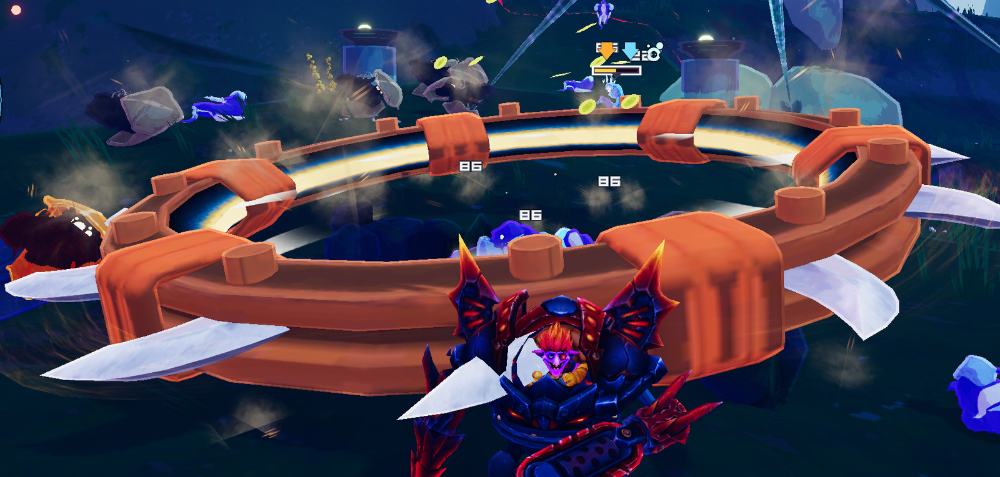
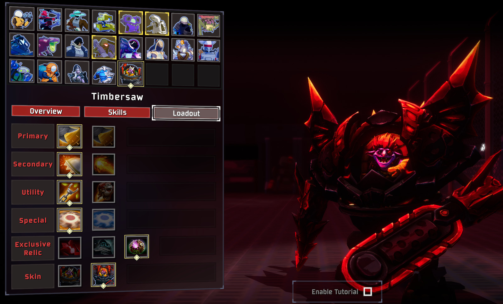
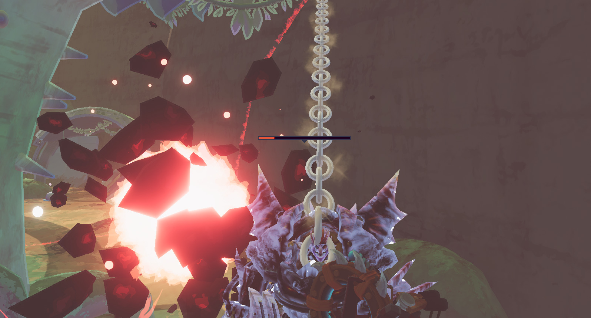

# Timbersaw

Bring the frantic lumberjack of Dota 2 to Petrichor V.

Timbersaw is a mobile melee survivor who tears through crowds with spinning blades, reactive armor, and a very unhealthy fear of trees. Pull yourself into the fight with Timber Chain, hold your ground with Reactive Armor, and send a Chakram through anything still standing.

[Thunderstore](https://thunderstore.io/c/riskofrain2/p/DDL/Timbersaw/) · [GitHub](https://github.com/DDLovo/Timbersaw) · [Report an issue](https://github.com/DDLovo/Timbersaw/issues)

- Adds **Timbersaw** as a separate playable survivor.
- Includes the **Classic** appearance and complete **Molten Destructor** set, with Dota-derived selection animations.
- Choose between **eight skills** and **three exclusive relics**.
- Features Dota-derived models, animations, icons, and skill sounds, with effects adapted for Risk of Rain 2.
- Includes **English and Simplified Chinese** text and optional **LookingGlass** proc information.

## Overview

Timbersaw thrives in the middle of a crowd. Build momentum with Timber Chain to strengthen Whirling Death, or choose Exposure Therapy to turn each extra target into more damage and healing.

Reactive Armor rewards staying in the fight, while Flamethrower adds sustained fire without locking you out of other skills. Use Jetpack to reach enemies above you, or keep Timber Chain for fast engagements and repositioning.

## Skills

Cooldowns are base values before item modifiers. Damage percentages are relative to Timbersaw's damage stat unless stated otherwise. Attack speed shortens the cooldown of both primary skills.

| Slot | Skill | Description | Cooldown |
| --- | --- | --- | --- |
| Primary | **Whirling Death** | Cut enemies within 10m for **340% damage**, gaining another **30%** per m/s above 7. Deal an additional **13% of the target's maximum health**, reduced to **5% against bosses**. Attack speed reduces its 4s cooldown. | 4s |
| Primary | **Exposure Therapy** | Replace momentum scaling with **100% additional damage per extra target**, with no target limit. Keep the maximum-health damage and heal **2.5% of your maximum health per enemy damaged**. | 4s |
| Secondary | **Reactive Armor** | Enemy hits build up to **40 stacks**, each granting **3 armor** and regeneration. Activate to gain full stacks and **25% barrier** for 6s. Nearby enemies replenish the barrier. Breaking or expiring consumes it in a **200%–2000% damage** explosion. | 18s |
| Secondary | **Flamethrower** | Replace Reactive Armor with an **8s**, 14m cone of fire dealing **240% damage per second**, igniting enemies and slowing them by **40%**. Other skills remain available. | 18s |
| Utility | **Timber Chain** | Latch onto terrain or an enemy within **45m**, scaling with movement speed, and pull yourself toward it, dealing **400% damage** along the way. A missed chain has a **1s cooldown**. Pull speed starts at **30 m/s** and gains **50%** of movement-speed bonuses. | 4s |
| Utility | **Jetpack** | Fly for **10s**, starting at sprint speed and gaining **0% to 200% additional speed** over the flight. **18s cooldown**. Steer with your aim, hold Jump to rise, and hold Sprint to descend. Use other skills while airborne. | 18s |
| Special | **Chakram** | Hold to aim and release a **6m-radius** blade for **600% damage**. It stops at the previewed destination for **150% damage every 0.5s**. Press again to recall it for another **600% damage**. | 8s |
| Special | **Twisted Chakram** | Hold to preview, then release a **6m-radius** blade through a crossing, three-dimensional path for **1000% damage per pass**. Each enemy can be hit once outward and once on return. The blade returns automatically. | 8s |

**Sawing:** Both Chakrams slow enemies, including bosses, by **5%–100%** based on missing health. Chakram and Flamethrower slows linger for **2s**. Shiva's Guard does not slow bosses.

**Chakram control:** Hold the special skill to aim, then release to throw. Regular Chakram previews its full damage area and highlights eligible targets; press again to recall it. Twisted Chakram previews its flight path and returns automatically. Only one blade can be active per player. Both variants can hit enemies above and below the blade's plane.

**Timber Chain:** Range receives the full movement-speed bonus, while pull speed receives **50%** of that bonus. Slows affect both at full strength. The pull retains some momentum when it ends.

## Exclusive Relics

Choose one relic in the loadout menu. Relics are passive choices and do not occupy your equipment slot.

| Relic | Effect |
| --- | --- |
| **Bloodstone** | Heal for **5% of direct skill damage dealt**. Maximum-health damage, burns, and independent item damage do not heal. |
| **Shiva's Guard** | Slow non-boss enemies within **50m by 40%** and increase active skill areas by **20%**. Travel distance and duration remain unchanged. |
| **Octarine Core** | Reduce all skill cooldowns by **25%**. |

## Skins

**Classic** — Timbersaw's original machine, saws, and panicked pilot.

**Molten Destructor** — The complete six-piece set, including its original drill and chainsaw.

Both skins and all loadout choices are available immediately.

## Multiplayer and Configuration

**All players must have this mod enabled at the same version.** Timbersaw is independent of DrowRanger and Sven. Multiplayer edge cases still need broader testing.

Skill sound volume is configurable in `BepInEx/config/Timbersaw.cfg`, created on first launch. Original skill audio currently uses a Windows audio backend; these custom sounds are unavailable on other platforms.

With **LookingGlass** installed, skill tooltips can display proc coefficients. LookingGlass is optional.

## Feedback

When reporting an issue, include the mod version, skin and loadout, other installed mods, and whether you were hosting or joining. A short reproduction sequence and `BepInEx/LogOutput.log` are helpful. Include a screenshot or short clip for visual issues.

Feel free to [email me](mailto:ddlddl100086@gmail.com) or open a [GitHub issue](https://github.com/DDLovo/Timbersaw/issues).

## AI Disclosure

AI tools assisted with programming, documentation, asset adaptation, and some UI icon artwork. Portraits are rendered from the character models; the screenshots above were captured in-game.

## Credits

- **DDL** — Mod design, adaptation, testing, and screenshots.
- **Valve / Dota 2** — Timbersaw models, animations, textures, icons, and sounds. Jetpack effects and its icon draw on Clockwerk's resources.
- **Hopoo Games / Gearbox** — Risk of Rain 2.
- **BepInEx and Risk of Thunder / R2API contributors** — Mod loading and survivor integration tools.
- **ValveResourceFormat / Source 2 Viewer and Blender contributors** — Asset inspection, extraction, and conversion tools.

This is an unofficial fan mod and is not affiliated with Valve or the Risk of Rain 2 developers. Character assets belong to their respective creators. Source 2 effects are adapted for Unity.
